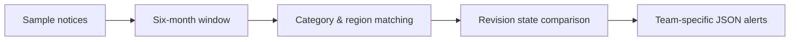

# Framework & Tender Intelligence Tracker

> **Independent public demonstration.** Uses fictional procurement notices and team rules. It is not employer-owned contract-monitoring software.

A small, standard-library Python alert engine that looks ahead **183 days**, maps opportunities to relevant teams and only raises a new alert when the notice revision changes.

## Why I built this
Framework opportunities are time-sensitive. A sales team needs to know what is upcoming and what changed, without reading every notice manually or receiving the same alert repeatedly.

## What works
- Six-month eligibility window based on a release offset
- Category and region based relevance rules for sales/engineering teams
- Revision-aware deduplication, with local `.demo_state.json`
- Human-readable JSON alerts that can feed future integrations
- Six automated regression tests, run by GitHub Actions

## Run
Requires Python 3.10+, with no third-party packages.

```bash
python tracker.py
python tracker.py      # unchanged notices do not generate repeated alerts
python -m unittest discover -s tests -v
```

Delete `.demo_state.json` to restart the example. Edit the `revision` in `sample_notices.json` to simulate an update.

## Architecture


**Demo limitations:** It does not scrape external procurement platforms or send real emails/Teams messages. Those would be separate adapters requiring permissions and deployment infrastructure.

## Provenance and data safety
All public records are synthetic. Work performed in previous roles inspired this example, but no company code, credentials, pricing, partner identities or real notice feeds are published.
